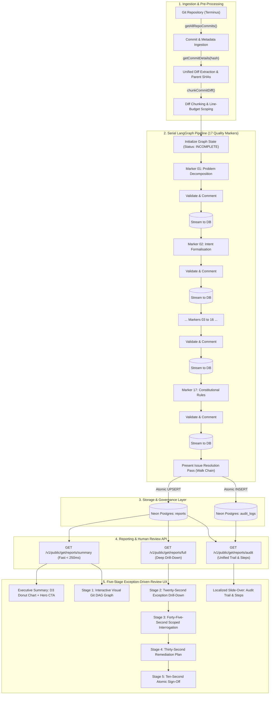

# Nova Orchestrator — Data Ingestion & Reporting Pipeline Outline

**System Version:** 2.0.0  
**Target Platform:** Terminus Autonomous Research Platform  
**Architecture:** Serial LangGraph + Neon PostgreSQL + SvelteKit 2 (Svelte 5)  
**Standard:** 17 Quality Markers (of AI-Generated Code)  

---

## 1. End-to-End Pipeline Architecture

Nova Orchestrator ingests Git commits from autonomous research repositories, processes code diffs through a deterministic serial LangGraph evaluation chain across **17 Quality Markers (of AI-Generated Code)**, persists incremental progress to Neon Postgres with atomic audit logging, and surfaces findings to human reviewers via an exception-driven dashboard in under two minutes.



---

## 2. Ingestion Layer: Extraction & Pre-Processing

### 2.1. Git Commit Extraction (`src/lib/github/client.ts`)
- **Repository Traversal**: Fetches commits in reverse-chronological order from the target branch (defaults to `main`).
- **Parent Lineage Tracking**: Every extracted commit object includes `parents` (an array of parent commit SHAs), enabling authentic client-side Git Directed Acyclic Graph (DAG) reconstruction.
- **Diff Normalization**: Extracts unified git diffs, file lists, author metadata, and raw commit messages.

### 2.2. Diff Chunking & Line-Budgeting (`src/lib/runner/chunker.ts`)
- **File Boundary Splitting**: Partitions large commits along file boundaries to prevent LLM context-window overflow.
- **Syntactic Hunk Formatting**: Tags line additions (`+`), deletions (`-`), and header contexts (`@@ ... @@`).
- **Context Budgeting**: Filters out binary assets (e.g. `.parquet`, `.png`) and caps code hunk size to respect model input budgets while preserving essential defect logic.

---

## 3. Evaluation Layer: The 17 Quality Markers Pipeline

The evaluation pipeline (`src/lib/runner/graph.ts`) executes strictly in **series**, eliminating concurrent request bursts and preventing upstream LLM rate-limit exhaustion (`429 Too Many Requests` on 15 RPM tiers).

### 3.1. Quality Markers Breakdown & Hierarchy

| Code | Key | Domain | Marker Name & Core Evaluation Focus |
| :--- | :--- | :--- | :--- |
| **VBC-01** | `problem_decomposition` | Defensive Rigor | **Problem Decomposition**: Verifies atomic commit scope adhering to formal task decomposition without mixing unrelated concerns. |
| **VBC-02** | `intent_formalisation` | Defensive Rigor | **Intent Formalisation**: Checks commit message clarity for explicit "what and why" explanations rather than vague placeholders. |
| **VBC-03** | `context_window_economics` | Resource Lifecycle | **Context Window Economics**: Detects full-file dump antipatterns and verifies token-efficient payload building. |
| **VBC-04** | `context_engineering_ontology` | Data Integrity | **Context Engineering & Ontology**: Inspects alignment with central domain terminology, data contracts, and schema types. |
| **VBC-05** | `formal_constraint_tdd` | Defensive Rigor | **Formal Constraint TDD**: Verifies unit and property tests were introduced alongside code modifications. |
| **VBC-06** | `diff_scepticism_and_artefacts` | Defensive Rigor | **Diff Scepticism & Artefacts**: Flags phantom edits, unintentional whitespace drift, and uncommitted debug artifacts. |
| **VBC-07** | `advanced_code_search` | Architecture | **Advanced Code Search**: Checks whether existing shared utilities were reused rather than duplicated or reinvented. |
| **VBC-08** | `loop_mitigation_governor` | Constitutional | **Loop Mitigation Governor**: Verifies programmatic loop bounds, retry TTL caps, and recursion guardrails. |
| **VBC-09** | `protocol_driven_mcp` | Resource Lifecycle | **Protocol-Driven MCP**: Evaluates tool calls, MCP servers, and external interfaces against least-privilege scoping. |
| **VBC-10** | `self_healing_reflection` | Defensive Rigor | **Self-Healing Reflection**: Checks automated error capture and structured recovery without unhandled panics. |
| **VBC-11** | `anchoring_bias_isolation` | Architecture | **Anchoring Bias Isolation**: Flags hardcoded mock values, stale constants, or magic numbers masquerading as production logic. |
| **VBC-12** | `unemotional_prompt_hygiene` | Constitutional | **Unemotional Prompt Hygiene**: Audits committed prompt templates for deterministic instructions without emotive padding. |
| **VBC-13** | `test_contingency_bypass` | Defensive Rigor | **Test Contingency Bypass**: Detects weakened assertions, mocked-out core logic, or skip-on-fail overrides. |
| **VBC-14** | `telemetry_attribution` | System Architecture | **Telemetry Attribution**: Verifies structured log emission, metrics attribution, and trace correlation IDs. |
| **VBC-15** | `harness_engineering` | Defensive Rigor | **Harness Engineering**: Inspects deterministic test harnesses and reproducibility of local test environments. |
| **VBC-16** | `deterministic_hooks` | Architecture | **Deterministic Hooks**: Audits pre-commit, pre-push, and CI pipeline hook enforcement. |
| **VBC-17** | `constitutional_global_rules` | Constitutional | **Constitutional Global Rules**: Guarantees adherence to immutable repository governance rules (`AGENTS.md`, system constraints). |

### 3.2. Sequential Stage Execution & Backoff Pacing
1. **Dynamic Rate Pacing**: After each LLM invocation, an inter-marker backoff delay pauses execution. If upstream signals `429 Too Many Requests`, the engine dynamically inspects Google Gemini `RetryInfo` headers and suspends execution until the quota window resets.
2. **Deterministic Stage Validation**: Outputs are parsed through strict Zod schemas (`VibeCriterionScoreSchema`).
3. **Mandatory Step Rationale**: Every step execution records an explicit **1–2 sentence human-readable rationale comment** documenting *why* it passed, warned, or failed.
4. **Live Write-Ahead Streaming (`streamProgressToDb`)**: Immediately writes intermediate step results and badge statuses to Neon Postgres, so the frontend reflects live evaluation status in real time.

---

## 4. Resolution & Persistence Layer

### 4.1. Cross-Commit Issue Resolution Walk (`runPresentIssueResolutionAgent`)
- After all 17 Quality Markers finish, the **Present Issue Resolution Agent** walks chronologically forward through subsequent commits.
- If a flagged defect was remediated in a newer commit, it stamps `resolved_by_commit = '<hash>'` and updates `remediation_status = 'RESOLVED'`.
- Allows human engineers to instantly see if a historical defect has already been cured by subsequent commits.

### 4.2. Database Persistence Architecture (`src/lib/db/`)
- **`reports` table**: Stores `hash`, `branch`, `validation_status` (`SAFE`, `FLAGGED`, `INCOMPLETE`), `composite_score` (percentage), `summary` JSONB (compact badges and metrics), and `full` JSONB (all 17 criterion verdicts, findings, and step logs).
- **`remediation_plans` table**: Manages hotfix specifications, patch diffs, and sign-off statuses (`PENDING_APPROVAL` $\rightarrow$ `RESOLVED`).
- **`audit_logs` table**: Immutable append-only audit trail logging every backend evaluation, manual review, and approval action within an ACID-compliant transaction.

---

## 5. Reporting & User Interface Flow

### 5.1. Executive Triage Summary
- **D3 Donut Chart (`TriageDonutChart.svelte`)**: High-level visual split of all evaluated commits across `Safe` (Emerald), `Flagged` (Rose), `Resolved` (Sky), and `Incomplete` (Amber) with total commit count in the center.
- **Hero CTA Card (`RecentFlaggedHeroCard.svelte`)**: High-priority alert banner prioritizing the most recent flagged commit with direct `Review & Interrogate Defect →` and localized `📜 Audit Trail & Steps` actions.

### 5.2. Visual Git DAG Timeline (Stage 1)
- **SVG Railway Tracks**: Renders commit nodes along branch lanes, drawing smooth bezier curves for branch forks and merges based on parent SHA lineage.
- **17-Marker Circle Status Strip**: Every commit card displays 17 interactive status circles color-coded by verdict (Emerald = Pass, Amber = Warn, Rose = Fail, Slate = N/A) with full criterion tooltips.

### 5.3. Exception-Driven Drill-Down (Stage 2)
- **Focused Code Diffs**: Suppresses full-file dumps; presents only the isolated code diff hunks with syntax highlighting tied directly to flagged findings.
- **Localized Audit Trail Drawer**: Localized button opens the complete audit trail (36 pipeline steps + database events) with real-time text search and filter toggles.

### 5.4. Scoped Interrogation & Remediation (Stages 3–5)
- **Stage 3 (Interrogation)**: AI chat scoped specifically to the flagged finding's code diff, rendered in GitHub Flavored Markdown with `@tailwindcss/typography` (`prose prose-invert prose-xs`).
- **Stage 4 (Lock and Plan)**: Locks conversation into `PENDING_APPROVAL` and formulates a read-only remediation patch.
- **Stage 5 (Approval Gate)**: Lead reviewer approves the plan, atomically recording the sign-off in `audit_logs` and marking the commit resolved.

---

## 6. Execution Commands & Operational Runbooks

### Batch Evaluation Runner
```powershell
# Evaluate all commits in repository (reverse-chronological)
npx tsx scripts/runner.ts

# Evaluate with commit limit (e.g. latest 3 commits)
npx tsx scripts/runner.ts --limit=3

# Force re-evaluation of already evaluated commits
npx tsx scripts/runner.ts --force --limit=1
```

### Database Inspection & Verification
```powershell
# Inspect database row counts, sample report schema, and step comments
npx tsx scripts/inspect-db.ts

# Run end-to-end API route protection and audit endpoint test suite
npx tsx scripts/test-api.ts

# Compile and check TypeScript & Svelte runes (must be 0 errors, 0 warnings)
npm run check
```
