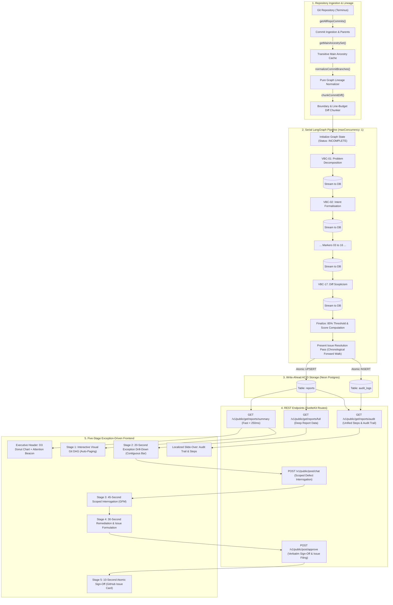

# Nova Orchestrator — Product Specification (Version 2.0.0)

**Document Version:** 2.0.0  
**Status:** Approved Canonical Specification  
**Effective Date:** October 19, 2026  
**Target Platform:** Terminus Autonomous Quantitative Research Platform  
**Target Environment:** SvelteKit 2 (Svelte 5 Runes) + Tailwind CSS + Neon Serverless PostgreSQL + Serial LangGraph + Google Gemini  

---

## 1. Executive Summary

Nova Orchestrator is a specialised commit review control plane designed to integrate with **Terminus**, an autonomous research process automation platform. Nova streamlines human-in-the-loop oversight of high-velocity, autonomous AI code contributions, reducing review time from hours to under two minutes per commit while applying automated contextual safety judgements.

Version 2.0.0 represents a comprehensive architectural evolution from the initial Proof-of-Concept baseline. Key production enhancements include:
1. **The 17 Quality Markers (of AI-Generated Code)**: A domain taxonomy specifically engineered to detect the characteristic failure modes of autonomous coding agents (assertion weakening, copy-paste churn, context-window dumping, silent error swallowing, prompt softening, and hallucinated dependencies), superseding legacy generic software categories.
2. **Serial LangGraph State Graph with Dynamic Pacing**: A deterministic, rate-limit-aware linear pipeline that guarantees ordered write-ahead progress streaming to Neon Postgres while eliminating upstream LLM `429 Too Many Requests` quota exhaustion.
3. **Interactive Visual Git Directed Acyclic Graph (DAG)**: Authentic multi-lane SVG timeline rails with cubic bezier fork/merge geometry, branch lane attribution, and infinite scroll auto-paging.
4. **Dual Cross-Commit Defect Resolution**: Combining algorithmic chronological forward-walk detection with interactive human reviewer sign-off that files tracked GitHub issues via Octokit.
5. **Localised Auditability & Step Rationales**: Direct access to full diagnostic traces and mandatory 1–2 sentence step rationales on every report through a slide-over audit drawer.
6. **Executive Triage Layer**: D3-driven interactive donut visualizations and ambient ghosted navigation, guiding human attention immediately to high-priority defects without cognitive anchoring.

---

## 2. System Requirements

### 2.1. Functional Requirements

#### FR-01: Git Commit Ingestion & Authentic Lineage Reconstruction
- **Repository Traversal**: Traverses Git history in reverse-chronological order across one or all branches.
- **Parent Hash Tracking**: Extracts `parents` arrays for every commit to compute branch lanes, fork points, and merge commits.
- **Transitive Ancestry Normalization**: Computes transitive main ancestry (`getMainAncestrySet`) and re-attributes commits belonging to `main`'s history back to `main`, preventing duplicate cards and false orphan branch tags.
- **Unified Diff Chunking**: Extracts unified diffs, partitions hunks along file boundaries, filters binary assets (e.g. `.parquet`, `.png`), and scopes line budgets to respect model context windows.

#### FR-02: Evaluation across 17 Quality Markers (of AI-Generated Code)
- Evaluates every commit against the **17 Quality Markers** grouped across five empirical pillars:
  1. *Architecture & Decomposition*: `VBC-01` Problem Decomposition, `VBC-02` Intent Formalisation.
  2. *Context Window & Retrieval*: `VBC-03` Context Window Economics, `VBC-04` Context Engineering Ontology, `VBC-05` Anchoring Bias Isolation, `VBC-06` Advanced Code Search.
  3. *Execution Boundaries & Telemetry*: `VBC-07` Harness Engineering, `VBC-08` Telemetry Attribution, `VBC-11` Deterministic Hooks.
  4. *Verification & Loop Safety*: `VBC-09` Formal Constraint TDD, `VBC-10` Test Contingency Bypass, `VBC-13` Self-Healing Reflection, `VBC-14` Loop Mitigation Governor.
  5. *Governance & Artifact Skepticism*: `VBC-12` Unemotional Prompt Hygiene, `VBC-15` Protocol-Driven MCP, `VBC-16` Constitutional Global Rules, `VBC-17` Diff Scepticism & Artefacts.
- Synthesizes backwards-compatible legacy 7-domain aliases (`TST`, `API`, `UI`, `FIN`, `SYS`, `SEC`, `OPS`) for compatibility.

#### FR-03: Dual Cross-Commit Defect Resolution Pathways
- **Pathway 1 (Algorithmic Forward Walk)**: `runPresentIssueResolutionAgent` walks subsequent commits in the ingested branch batch to identify whether a downstream code modification resolves earlier findings, stamping `resolved_by_commit = '<hash>'`.
- **Pathway 2 (Human Sign-Off & GitHub Issue Filing)**: Reviewer inspects a defect in chat, finalizes remediation requirements, and signs off. The system automatically creates a tracked GitHub issue via `@octokit/rest`, stamps `resolved_by_commit = 'gh-issue-<number>'`, transitions status to `RESOLVED`, and logs an immutable audit event.

#### FR-04: Five-Stage Exception-Driven Review Workflow
- **Executive Summary Header**: Interactive D3 Donut Chart (`TriageDonutChart.svelte`) with proportional segment splits (`Safe`, `Flagged`, `Resolved`, `Incomplete`) and centered commit counter.
- **Stage 1 (Five-Second Branch Triage)**: Visual Git DAG with bezier fork/merge lanes, status-colored node core dots, 17-marker solid circle strip, and infinite scroll auto-paging (25 commits per page).
- **Stage 2 (Twenty-Second Exception Drill-Down)**: Streamlined status-scoped views:
  - *Resolved*: Displays "Issue Resolved" banner and live GitHub issue preview card or resolving commit card.
  - *Flagged*: Highlights failed criteria badges, defect critiques, and diff hunks.
  - *Passed*: Displays passing Quality Markers with confidence scores.
  - *Contiguous Bar*: Shows the 17-stage pipeline as a stacked horizontal bar where passed stages are thin green segments with no numbers, and failing/incomplete stages expand to display their stage number and issue tag (e.g. `04 #3BV80`, `08 #PEND`).
  - *Secondary Metadata*: Collapsed behind a discrete grey `[ Show full details ]` toggle.
- **Stage 3 (Forty-Five-Second Scoped Interrogation)**: GitHub Flavored Markdown (GFM) streaming chat scoped to the specific defect context (`hash`, `issue_id`, `domain_category`, `diff_hunk`, `file_path`, `finding_reasoning`).
- **Stage 4 (Thirty-Second Remediation & Issue Formulation)**: Formulates structured remediation plans with Problem Statement, Defect Critique, and Proposed Action Graph.
- **Stage 5 (Ten-Second Atomic Sign-Off)**: Human approval triggers GitHub issue creation and marks the commit resolved. Automated PR deployment remains permanently disabled as an architectural safety guardrail.

#### FR-05: Localised Per-Report Audit Trail & Step Log Drawer
- Unified endpoint (`GET /v1/public/get/reports/audit?hash={hash}`) merging runner step logs (`full.steps`) and database audit logs (`audit_logs`) chronologically.
- Slide-over drawer with free-text search, category filters (`ALL`, `STEPS`, `AUDIT`), JSON payload inspector, and mandatory 1–2 sentence step rationales (`comment`) for every evaluation step.

---

### 2.2. Non-Functional Requirements

#### NFR-01: Serial Linear Chain & Rate-Limit Resilience
- The evaluation state graph executes sequentially (`node_prepare` $\rightarrow$ `Criterion_1` $\rightarrow$ ... $\rightarrow$ `Criterion_17` $\rightarrow$ `finalize` $\rightarrow$ `resolution` $\rightarrow$ `persist`) with `maxConcurrency: 1`.
- Dynamic Google RPC `RetryInfo` backoff parsing in `src/lib/ai/gemini.ts` inspects rate-limit response headers and text, sleeping the required duration (capped at 45 seconds) to eliminate burst `429 Too Many Requests` failures.

#### NFR-02: Write-Ahead Database Streaming
- Progress is persisted to Neon Postgres on every single step via `streamProgressToDb()` using atomic `INSERT ... ON CONFLICT (hash) DO UPDATE`, guaranteeing live dashboard updates in `<250ms` without checkpoint serialization overhead.

#### NFR-03: Strict 85% Confidence Gate & Whole-Percentage Formatting
- Scores $<85$ automatically demoted from `PASS` to `WARN`.
- Any `FAIL` or `WARN` criterion, or aggregate score $<85\%$, flags the commit as `FLAGGED`.
- All confidence scores strictly formatted as whole percentages with `%` (e.g. `92%`, `76%`, never raw floats).

#### NFR-04: Graceful `NA` Fallback Degradation
- If an individual criterion agent encounters an unrecoverable quota or network timeout, the stage records `status: 'NA'` / `execution_status: 'NA'` with explicit commentary, allowing the pipeline to finalize without aborting batch evaluation.

#### NFR-05: Route Security & ACID Consistency
- `v1/public/get/*`: Publicly accessible with CORS support.
- `v1/private/*`: Protected by internal bearer secret (`INTERNAL_BEARER_SECRET`).
- `v1/public/post/*`: Protected by client passcode header (`x-passcode`).
- All state updates, issue references, and audit logs execute within ACID transactions.

#### NFR-06: Code Quality Gate
- Strict compilation verification via `npm run check` with **0 errors and 0 warnings** required across all SvelteKit and TypeScript modules.

---

## 3. End-to-End System Architecture



---

## 4. The 17 Quality Markers (of AI-Generated Code)

The system replaces legacy software categories with 17 empirical markers addressing autonomous code generation failure modes:

| Marker Code | Criterion Key | Empirical Pillar | Core Verification Directive |
| :--- | :--- | :--- | :--- |
| **`VBC-01`** | `problem_decomposition` | Architecture & Scope | Audits commit for atomic single-concern scope; flags oversized omnibus commits that bundle unrelated changes. |
| **`VBC-02`** | `intent_formalisation` | Architecture & Scope | Audits commit messages and comments for explicit "what and why" intent rather than vague micro-updates. |
| **`VBC-03`** | `context_window_economics` | Context & Retrieval | Checks callers, queries, and chunking bounds for surgical context pruning rather than raw whole-file dumping. |
| **`VBC-04`** | `context_engineering_ontology` | Context & Retrieval | Enforces explicit domain schema contracts and typed constants over magic strings, numbers, or untyped bags. |
| **`VBC-05`** | `anchoring_bias_isolation` | Context & Retrieval | Verifies validator/critic context isolation from generation loops to prevent sycophantic validation passes. |
| **`VBC-06`** | `advanced_code_search` | Context & Retrieval | Scrutinizes repository search mechanisms for structured AST/indexed search rather than naive linear scans. |
| **`VBC-07`** | `harness_engineering` | Boundaries & Telemetry | Verifies environment boundaries, runtime configurations, and deterministic sandboxing across test suites. |
| **`VBC-08`** | `telemetry_attribution` | Boundaries & Telemetry | Flags empty/generic catch blocks that swallow errors; verifies newly committed logic emits structured telemetry. |
| **`VBC-09`** | `formal_constraint_tdd` | Testing & Verification | Verifies that functional code changes are accompanied by corresponding unit, integration, or property test additions. |
| **`VBC-10`** | `test_contingency_bypass` | Testing & Verification | Scrutinizes test modifications for weakened assertions, deleted expectations, or mocked-out core logic forcing green CI. |
| **`VBC-11`** | `deterministic_hooks` | Boundaries & Telemetry | Enforces programmatic validation via Zod schemas, linters, and pre-commit hooks rather than prompt-based wishes. |
| **`VBC-12`** | `unemotional_prompt_hygiene` | Governance & MCP | Inspects prompts for concise, deterministic technical instructions free of conversational fluff and sycophancy. |
| **`VBC-13`** | `self_healing_reflection` | Testing & Verification | Verifies that automated retry loops incorporate diagnostic feedback rather than blind repetition. |
| **`VBC-14`** | `loop_mitigation_governor` | Testing & Verification | Enforces strict Time-To-Live (TTL) hop limits, circuit breakers, and repetition detectors on while loops and agent graphs. |
| **`VBC-15`** | `protocol_driven_mcp` | Governance & MCP | Enforces least-privilege schemas, parameter validation, and bounded authority on Model Context Protocol (MCP) tools. |
| **`VBC-16`** | `constitutional_global_rules` | Governance & MCP | Detects silent weakening, loosening, or deletion of repository governance rules (`AGENTS.md`, `.cursorrules`, `tasks.md`). |
| **`VBC-17`** | `diff_scepticism_and_artefacts` | Governance & MCP | Audits diffs for copy-pasted code duplication, orphaned artifacts, dead imports, and hallucinated external APIs. |

---

## 5. Frontend Information Architecture & Visual Language

### 5.1. Atmospheric Ghosted Watermark Navigation
- **Default State**: When no commit is selected (`selectedCommit = null`), the top navbar chrome is replaced by a centered ambient watermark:
  ```
  NOVA ORCHESTRATOR
    for Terminus
  ```
- **Active State**: Upon commit selection, navbar activates with commit SHA, branch badge, verdict pill, and a `✕ Deselect` button.
- **Empty Detail Pane**: When unselected, Stage 2 renders an explicit `⌥ No Commit Selected` triage placeholder.

### 5.2. Executive Triage Layer
- **D3 Reactive Donut**: Renders a proportioned donut chart (`#10b981` Safe, `#f43f5e` Flagged, `#38bdf8` Resolved, `#f59e0b` Incomplete) with center commit counter and interactive segment hovering.

### 5.3. Stage 1 Visual Git DAG & Auto-Paging
- **SVG Lanes**: Renders authentic multi-track Git branch lanes with cubic bezier fork and merge paths.
- **Node Core Dots**: Colored by verdict (`#38bdf8` Resolved, `#10b981` Safe, `#f43f5e` Flagged, `#eab308` Incomplete).
- **Quality Marker Circles**: 17 solid color-coded dots (`w-2.5 h-2.5 rounded-full`) with hover tooltips displaying criterion name, score, and status.
- **Infinite Scroll**: Sentinel element triggers auto-paging of the next 25 commits via an `IntersectionObserver`.

### 5.4. Stage 2 Detail Pane & Contiguous Quality Markers Bar
- **Stacked Contiguous Bar**:
  - Green passed stages are collapsed into thin vertical strips (`w-2.5 sm:w-3.5`) with no numbers.
  - Failing (`bg-rose-600`) and incomplete/warning (`bg-yellow-400 text-slate-950 font-bold`) stages expand to fill remaining width, displaying stage number and issue reference (e.g. `04 #3BV80`, `08 #PEND`).
  - Bar sits seamlessly without a nested card container.
- **Streamlined Status Views**:
  - *Resolved*: Displays "Issue Resolved" banner and live GitHub issue preview card (`GitHubIssueCard.svelte`) or resolving commit preview.
  - *Flagged*: Highlights failed criteria, critiques, and code diffs.
  - *Passed*: Displays passing criteria with confidence scores and "Why it passed" comments.
  - *Collapsible Metadata*: Secondary diagnostic data collapsed behind a grey `[ Show full details ]` toggle.

### 5.5. Stage 3/4/5 Remediation, Issue Formulation & Verbatim Sign-Off
- **Scoped Chat**: Contextually bound to the active defect, rendering GFM code blocks and diffs via `marked`.
- **Interactive Issue Drafter**: Reviewer can edit the drafted issue title and body directly before approving.
- **Verbatim Approval**: Reviewer typing "Approve" or clicking the sign-off button invokes `/v1/public/post/approve`, creating a GitHub issue, marking the report resolved, and rendering live issue metadata.
- **Deployment Guardrail**: Automated PR creation remains permanently disabled.

---

## 6. Complete API Route Specification

| Route Path | HTTP Method | Auth / Access Gate | Key Parameters / Body | Response Contract & Payload |
| :--- | :---: | :---: | :---: | :--- |
| `/v1/public/get/reports/summary` | `GET` | Public (CORS) | `branch` (opt), `page` (opt), `limit` (opt) | Returns array of `ReportSummary` with lineage, 17 Quality Marker badges, composite score, and resolution tag. Sorted timestamp DESC. |
| `/v1/public/get/reports/full` | `GET` | Public (CORS) | `hash` (req) | Returns complete `FullReport` with all 17 criteria evaluation objects, findings list, steps, and diff metadata. |
| `/v1/public/get/reports/audit` | `GET` | Public (CORS) | `hash` (req) | Aggregates pipeline execution steps and database audit logs into chronological sequence (~41 events). |
| `/v1/public/get/branches` | `GET` | Public (CORS) | None | Returns distinct list of active branches discovered across GitHub and database records. |
| `/v1/public/get/stats` | `GET` | Public (CORS) | `branch` (opt) | Returns aggregate counts: `total_reports`, `safe_count`, `flagged_count`, `resolved_count`. |
| `/v1/public/post/chat` | `POST` | `x-passcode` | `hash`, `messages`, `scoped_finding` (opt) | Server-Sent Events (SSE) streaming chat response scoped to defect context with GFM formatting. |
| `/v1/public/post/plan` | `POST` | `x-passcode` | `hash`, `messages`, `issue_id`, `scoped_finding` | Streams structured remediation plan and returns `x-nova-plan-id` header. |
| `/v1/public/post/approve` | `POST` | `x-passcode` | `hash`, `plan_id`, `issue_title`, `issue_body`, `issue_labels` | Creates GitHub issue via Octokit, stamps `resolved_by_commit = 'gh-issue-<num>'`, marks plan `RESOLVED`, logs audit event. |
| `/v1/private/sync` | `POST` | `INTERNAL_BEARER_SECRET` | `branch`, `force` (opt), `limit` (opt) | Triggers background repository sync and batch evaluation run. |

---

## 7. Product Roadmap Horizons (v2.1 to v2.4 & Cloud Horizon)

```
[ Version 2.0.0 Production Baseline (Current) ]
  ├── 17 Quality Markers Evaluation Standard (Fully Operational)
  ├── Serial LangGraph Chain with Gemini RPC RetryInfo Backoff
  ├── Interactive Visual Git DAG Lineage with Auto-Paging
  ├── Dual Cross-Commit Resolution & Octokit GitHub Issue Filing
  └── Localized Slide-Over Per-Report Audit Trail & Step Log Drawer

[ Version 2.1.0 — Content-Addressable Storage (Next Horizon) ]
  ├── Feature 2.1.1: Content-Addressable SHA-256 Diff Hashing (Skip re-evaluating rebased/cherry-picked commits)
  └── Feature 2.1.2: Commit Diff Cache Invalidation & Storage Pruning

[ Version 2.2.0 — Syntactic Parser Intelligence ]
  ├── Feature 2.2.1: Tree-Sitter AST Diff Splitting (Partition large changes strictly along function/class boundaries)
  └── Feature 2.2.2: Semantic Chunk Budgeting (Dynamic AST-aware token budgeting for large refactors)

[ Version 2.3.0 — Pre-Flight Compiler Gatekeeping ]
  ├── Feature 2.3.1: Zero-Token Syntax Linter Pre-Gate (Reject broken syntax before invoking LLM agents)
  └── Feature 2.3.2: Automated TypeScript AST Diagnostics Validation

[ Version 2.4.0 — Security Hardening & Secret Scrubbing ]
  ├── Feature 2.4.1: Pre-Ingestion Entropy & Regex Credential Scrubber (Strip accidental secrets prior to model ingestion)
  └── Feature 2.4.2: Neon Postgres Role Hardening (REVOKE UPDATE/DELETE on audit_logs at SQL role level)

[ Cloud Horizon — Distributed Multi-Tenant Architecture ]
  ├── Bounded Distributed Worker Task Queues with Backpressure
  ├── Multi-Worker Optimistic Concurrency Control (OCC) with Integer State Versioning
  └── Dead-Letter Queues (DLQ) for Poisoned or Malformed Commits
```
